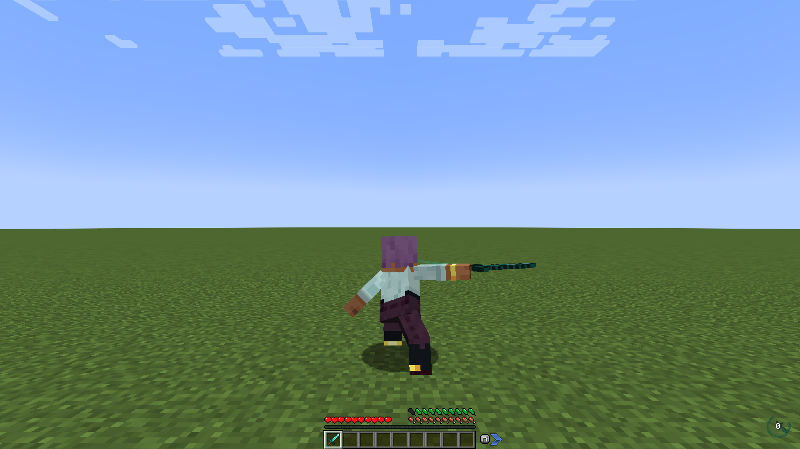

# Actions of Stamina

*Minecraft 1.21.1 · NeoForge. Also for 1.20.1 (Forge). [Minecraft Versions](Minecraft-Versions) tells what is different.*

Actions of Stamina (AoS) makes player actions cost stamina. Sprinting, jumping, attacking, swimming, crawling, elytra flight and a raised shield all cost stamina, and so do the actions of several popular movement and combat mods. Without enough stamina, the action does not happen: you cannot start to sprint, the jump is cancelled, the swing is dropped, the roll is not available.

AoS only decides **how actions cost stamina**. The stamina bar comes from [Feathers of Fatigue](https://github.com/Darkona/feathers-of-fatigue) when it is installed. Without it, AoS uses its own simple bar.

## Pages

- [Stamina Backends](Stamina-Backends): the feathers of Feathers of Fatigue, or the own bar of AoS.
- [Vanilla Actions](Vanilla-Actions): the cost of sprinting, jumping, attacking and the other vanilla actions.
- [Compatibility](Compatibility): Better Combat, Combat Roll, Wall-Jump TXF, Curios, Paragliders, ParCool, Epic Fight, Gliders and Create.
- [Configuration](Configuration): all the options.
- [Minecraft Versions](Minecraft-Versions): the differences on 1.20.1.
- [Addon API](Addon-API): for mod developers who want to add stamina-costing actions of their own.
